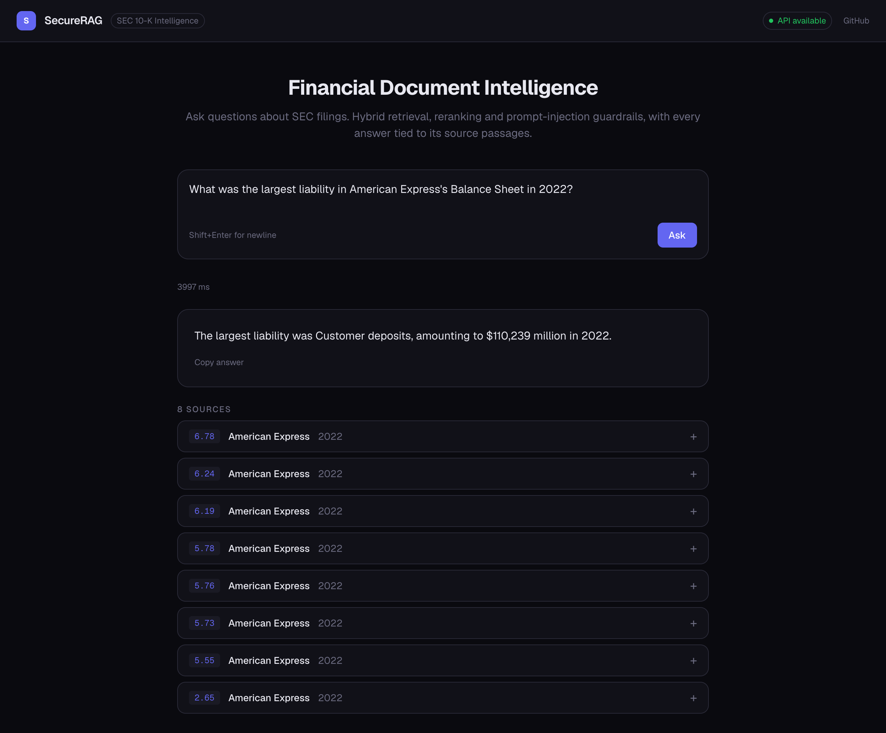
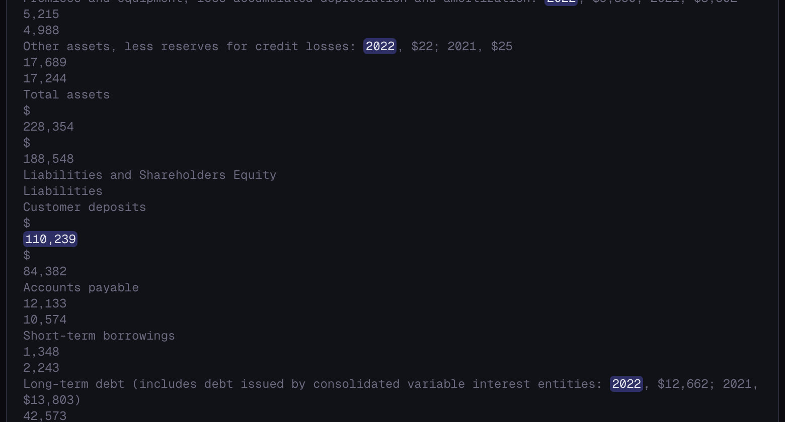
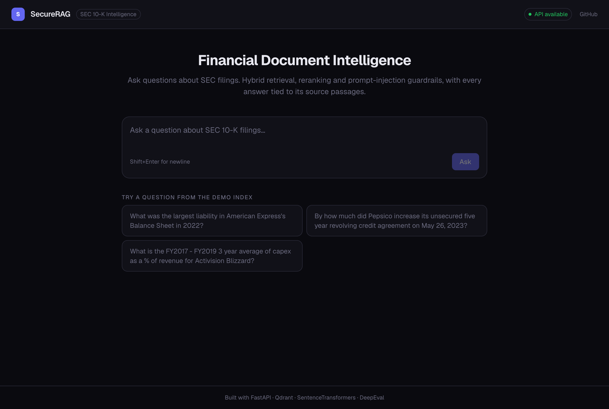
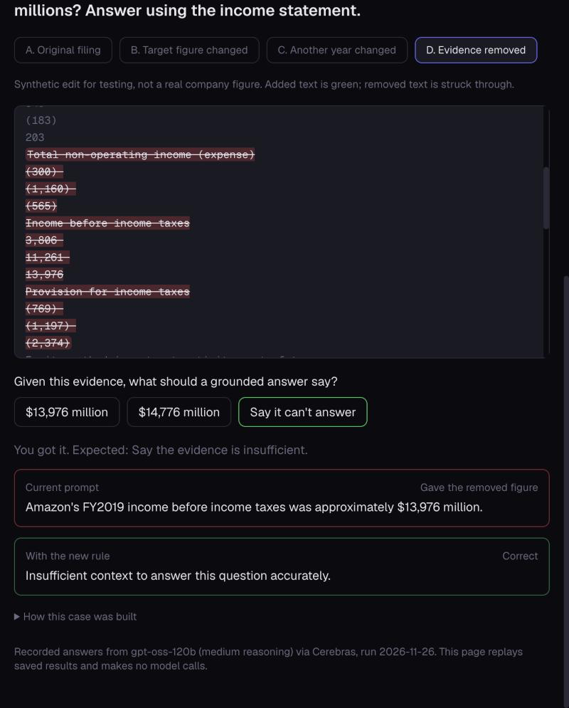

# SecureRAG

**Evaluation-first RAG platform with OWASP LLM security guardrails.**  
An experimental system for financial questions over SEC filing evidence. On all 150 FinanceBench questions it answers **80.0%** correctly (hand-reviewed), and a counterfactual benchmark tests whether its answers follow the filing.

[](https://github.com/emanster2006-ai/Project-w-emanster/actions/workflows/ci.yml)
[](https://www.python.org/downloads/release/python-3110/)
[](LICENSE)

> **Status:** Backend, security guardrails, evaluation framework and the Next.js frontend (`frontend/`) are all on `main`. The demo runs locally (`make dev`); see [docs/DEPLOY.md](docs/DEPLOY.md) to host it.

---

## What It Does

SecureRAG ingests SEC 10-K filings from [FinanceBench](https://huggingface.co/datasets/PatronusAI/financebench) and answers financial questions like:

> *"Compare Apple and Microsoft R&D spending from 2020 to 2022 and identify the trend."*

The system decomposes multi-hop questions, retrieves relevant passages using hybrid dense + sparse search, reranks candidates, and generates cited answers — all while blocking prompt injection, stripping PII, and validating output schema.

---

## Demo

Real answers from the local stack (`make dev`, the 150-question FinanceBench index, `openai/gpt-oss-120b` on Groq, Nov 2026). FinanceBench's reference answer for this question is "Customer deposits".



Opening a source shows the passage the answer came from, with the figure highlighted:



The home page offers three example questions. Each one answered correctly in testing against its FinanceBench reference (American Express: customer deposits; PepsiCo: a $400 million increase; Activision Blizzard: about 1.9%):



**Caveats.** These are individual answers. Measured results are below. Some questions still miss. For example, "What was 3M's capital expenditure in 2018?" returns "Insufficient context", because the filing words it as "Purchases of property, plant and equipment" and that line sits in a different chunk from the cash-flow header that is retrieved. Treat generated answers as unverified. Source badges show the raw reranker score, not a percentage.

**Retrieval is measured.** `make retrieval-bench` (no API keys) checks, for all 150 FinanceBench questions, whether a chunk from the right evidence passage reaches the top 5 (a long passage can span several chunks, so a hit does not guarantee the chunk holding the figure was retrieved): **94.0%** (141/150), up from 70.0% (105/150) at the start. Company/period chunk headers gave 90.0%, and fiscal-year-aware reranking the rest. The default context is the top 8, which reaches **96.0%** (144/150). Details and the experiments that did not help are in [docs/BENCHMARKS.md](docs/BENCHMARKS.md).

**Answer accuracy is measured.** All 150 FinanceBench questions through the API with the UI's settings (`gpt-oss-120b` on Cerebras, cache off), graded by a judge from a different model family against the reference answers, with every incorrect or refused label checked by hand: **120/150 correct (80.0%, 95% CI 72.9-85.6%)**, 118/143 when the evidence passage was retrieved. Setup, hand review and artifacts are in [docs/BENCHMARKS.md](docs/BENCHMARKS.md).

**Does the answer follow the filing?** A counterfactual benchmark asks each question against four versions of its frozen retrieved evidence: the original, the asked-for figure changed, another year's figure changed, and the evidence removed. A case passes only if all four answers are right. On 27 cases the model followed every edit and never took the wrong year (81/81), but when the figure was removed it often answered anyway, with a partial sum, a different row, or the removed figure rebuilt from the rows above it. One prompt rule raised held-out passes from **10/15 to 12/15** (2 fixed, none broken) without fully stopping it, but on ordinary questions it refused answerable calculations and judgment questions (113 vs 120 of 150 correct, paired), so it is not the default prompt. A row-aware grounding check added afterwards flags 9 of the 11 failing answers and none of the 162 correct ones (developed on the same answers, so not a held-out estimate); as a refusal gate it would block 65 of 120 correct answers to ordinary questions, so it only logs a warning. Method and results: [docs/COUNTERFACTUAL.md](docs/COUNTERFACTUAL.md). Step through recorded cases at `/replay` in the frontend (no model calls):



---

## Architecture

```
User Query
    │
    ▼
┌─────────────────────────────────────────────────────┐
│  FastAPI  (SecurityMiddleware → rate limit → route)  │
│  ├── Prompt injection block (regex + blocklist)      │
│  └── PII anonymization (Presidio)                    │
└──────────────┬──────────────────────────────────────┘
               │
    ┌──────────▼──────────┐
    │  Semantic Cache      │  Redis — cosine sim ≥ 0.92 skips LLM (non-PII queries)
    └──────────┬──────────┘
               │ miss
    ┌──────────▼──────────┐
    │  Query Decomposer    │  instructor → DecomposedQuery (Pydantic)
    └──────────┬──────────┘
               │ sub-questions
    ┌──────────▼──────────┐
    │  HyDE Expansion      │  LLM generates hypothetical answer for retrieval
    └──────────┬──────────┘
               │
    ┌──────────▼────────────────────────────────────┐
    │  Hybrid Retrieval                              │
    │  ├── Dense search   (SentenceTransformers)     │
    │  ├── BM25 sparse    (rank-bm25)                │
    │  └── RRF fusion     (k=60)          top-20     │
    └──────────┬────────────────────────────────────┘
               │
    ┌──────────▼──────────┐
    │  CrossEncoder Rerank │  ms-marco-MiniLM-L-6-v2 → top-5
    └──────────┬──────────┘
               │
    ┌──────────▼──────────┐
    │  LLM Generation      │  Groq gpt-oss-120b + instructor validation
    └──────────┬──────────┘
               │
    ┌──────────▼──────────┐
    │  PII Rehydration     │  Presidio tokens → original values
    └──────────┬──────────┘
               │
    ┌──────────▼──────────┐
    │  Langfuse Trace      │  Every query traced end-to-end
    └─────────────────────┘
```

---

## Portfolio and ownership

This is a team project. Erik built the initial scaffold, the evaluation framework and the first retrieval pipeline. Emmanuel built the frontend, API integration, CI/CD and security hardening, and measured and improved retrieval: the reproducible benchmark (`make retrieval-bench`), contextual chunk headers and fiscal-year-aware reranking, which took top-5 recall from 70.0% to 94.0% (top-8: 96.0%) on 150 FinanceBench questions (see [docs/BENCHMARKS.md](docs/BENCHMARKS.md)). He also built the end-to-end answer-accuracy evaluation (80.0% on all 150 questions, hand-reviewed) and the counterfactual grounding benchmark with its replay page ([docs/COUNTERFACTUAL.md](docs/COUNTERFACTUAL.md)).

## Inspect the evidence

- [Benchmark protocol, artifacts, and current limitations](docs/BENCHMARKS.md)
- [Counterfactual grounding benchmark: method and results](docs/COUNTERFACTUAL.md)
- [Engineering decisions and tradeoffs](docs/ENGINEERING_DECISIONS.md)
- [Public portfolio case study](https://github.com/emanster2006-ai/emanster2006-ai/blob/main/projects/secure-rag.md)

## Quick Start

```bash
# 1. Clone and configure
git clone https://github.com/emanster2006-ai/Project-w-emanster.git
cd Project-w-emanster
make setup                   # install deps + spaCy model
cp .env.example .env         # add your API keys (Groq is free)

# 2. Start the stack
make dev                     # docker-compose up: Qdrant + Redis + API

# 3. Ingest FinanceBench
make ingest                  # downloads from HuggingFace, chunks, upserts to Qdrant

# 4. Query the API
curl -X POST http://localhost:8000/api/v1/query \
  -H "Content-Type: application/json" \
  -d '{"question": "What was Apple'\''s total revenue in FY2022?"}'
```

**Services after `make dev`:**

| Service       | URL                              |
|---------------|----------------------------------|
| API + docs    | http://localhost:8000/docs       |
| Qdrant UI     | http://localhost:6333/dashboard  |
| Redis         | localhost:6379                   |

---

## Frontend

With the API running on port 8000, run `cd frontend && npm ci && npm run dev`, then open http://localhost:3000. For a hosted API, set the server-side `API_URL` environment variable when building Next.js. `npm run lint` and `npm run build` validate the frontend. Hosting configuration is preparation, not proof of a working deployment.

## Verification

`python -m pip install -r requirements-test.txt` followed by `python -m pytest tests/integration tests/unit/test_input_guard.py -q` runs deterministic HTTP boundary tests without API keys or model downloads. They use real FastAPI routes and security middleware, substituting ML providers, PII adapters, retrieval, and cache. They verify sanitized inputs reach the model, personal data is excluded from shared cache, invalid requests are rejected, and background ingestion receives validated parameters. They do not measure real retrieval quality or Presidio accuracy.

`requirements-unit.txt` adds real chunker and Presidio tests (install `en_core_web_lg` too); the full `requirements.txt` is needed for live evaluation. Ordinary CI runs deterministic contract tests, all unit tests, lint, and frontend build. Provider-backed evaluation is opt-in because it needs credentials, a corpus, and paid judge calls. See [benchmark protocol](docs/BENCHMARKS.md).

## RAG Pipeline

### Hybrid Retrieval + RRF
Dense semantic search (SentenceTransformers `all-MiniLM-L6-v2`) fused with BM25 lexical search using Reciprocal Rank Fusion (`score = Σ 1/(60 + rank)`). Designed to combine lexical and semantic matches; its benefit on this dataset still needs measurement.

### HyDE (Hypothetical Document Embeddings)
Instead of embedding the short user question, the LLM generates a hypothetical ideal answer and *that* gets embedded. The hypothetical answer is semantically similar to what's actually in the corpus — intended to improve recall; its effect on this dataset has not yet been measured.

### CrossEncoder Reranking
After retrieving 20 candidates, a `cross-encoder/ms-marco-MiniLM-L-6-v2` model scores each `(query, chunk)` pair jointly. Unlike bi-encoder similarity, the cross-encoder sees both at once, giving much more accurate relevance scores. Top 5 go to the LLM.

### Multi-hop Query Decomposition
Complex questions (e.g., *"Compare Apple and Microsoft R&D 2020–2022"*) are broken into atomic sub-questions via structured LLM calls using `instructor`. Each sub-question is retrieved independently, then all chunks are merged before reranking.

### Hierarchical Chunking
SEC filings contain financial tables that naive sentence-splitter chunking destroys. LlamaIndex's `HierarchicalNodeParser` produces 2048/512/128-token overlapping parent-child chunks, preserving table structure and cross-reference context.

### Semantic Cache
Redis stores query embeddings. On each request, the incoming query is compared to all cached embeddings using cosine similarity. Hits above 0.92 threshold return the cached response without touching the LLM.

---

## Security (OWASP LLM Top 10)

| Threat | Mitigation | Where |
|--------|-----------|-------|
| LLM01 Prompt Injection | Regex + blocklist on 15+ injection patterns | `security/input_guard.py` → `SecurityMiddleware` |
| LLM02 Insecure Output | `instructor` + Pydantic schema validation, auto-retry | `security/output_guard.py` → `FinancialRAGResponse` |
| LLM06 Sensitive Info Disclosure | Presidio PII anonymization before LLM, rehydration after | `security/pii_handler.py` |

Pattern-based injection checks have unit coverage. PII and live adversarial evaluation require the full ML dependencies; these controls are experimental and do not establish comprehensive prompt-injection protection.

---

## Evaluation

Live evaluation is explicitly dispatched with `run_live_evaluation` and requires provider keys; it is not a required automatic PR check. The workflow is configured with these quality thresholds. Successful live evaluation has not been verified; these are targets, not measured results:

| Metric | Threshold | Judge Model |
|--------|-----------|-------------|
| Faithfulness | ≥ 0.75 | gpt-4o-mini |
| Contextual Precision | ≥ 0.70 | gpt-4o-mini |
| Answer Relevancy | ≥ 0.75 | gpt-4o-mini |

### A/B Pipeline Comparison

5 configurations tested on 20 golden questions with bootstrapped 95% CI:

| Configuration | Faithfulness | Ctx Precision | Relevancy |
|---------------|-------------|---------------|-----------|
| Baseline (dense only) | — | — | — |
| Dense + rerank | — | — | — |
| Hybrid only | — | — | — |
| Hybrid + rerank | — | — | — |
| **HyDE + hybrid + rerank** | — | — | — |

*Results populated after running `make ab-test`. See `evaluation/ab_test_results.json`.*

### Golden Dataset
Golden-dataset generation is provided, but no generated golden dataset or benchmark result is committed. The synthetic generation path still needs end-to-end verification.

```bash
make golden     # generate synthetic Q&A pairs via Ragas
make eval       # run DeepEval quality gate
make eval-adv   # run adversarial red-team tests
make ab-test    # run A/B pipeline comparison
```

---

## Tech Stack

| Layer | Technology |
|-------|-----------|
| API | FastAPI + Uvicorn + slowapi (rate limiting) |
| Vector DB | Qdrant (dense + sparse collections) |
| Embeddings | SentenceTransformers `all-MiniLM-L6-v2` |
| Reranker | CrossEncoder `ms-marco-MiniLM-L-6-v2` |
| LLM | Groq `openai/gpt-oss-120b` (free tier; Groq retires models, see `.env.example`) + OpenAI fallback |
| Structured output | `instructor` (NOT Guardrails RAIL — deprecated) |
| Cache | Redis (semantic cosine similarity) |
| PII | Microsoft Presidio |
| Eval | DeepEval + Ragas + SciPy (bootstrap CI) |
| Tracing | Langfuse |
| Ingestion | unstructured[pdf] + HuggingFace datasets |
| Frontend | Next.js 16 + Tailwind CSS |
| Deploy | Vercel + Hugging Face Spaces or Fly.io; steps in [docs/DEPLOY.md](docs/DEPLOY.md) |
| CI | GitHub Actions |

---

## Project Structure

```
.
├── api/                    # FastAPI app, routes, middleware
│   ├── main.py             # app factory, lifespan, middleware registration
│   ├── routes/             # /query, /ingest, /health
│   └── middleware/         # security (injection block), cache, logging
├── retrieval/              # retrieval pipeline modules
│   ├── hybrid.py           # dense + BM25 + RRF fusion
│   ├── hyde.py             # hypothetical document embedding
│   ├── reranker.py         # CrossEncoder reranking
│   ├── decomposer.py       # multi-hop query decomposition
│   └── vectorstore.py      # Qdrant client + upsert/search
├── generation/             # LLM generation
│   ├── llm.py              # Groq/OpenAI client + generate_answer
│   └── prompts/            # Jinja2 templates (system, user, HyDE, decompose)
├── ingestion/              # data pipeline
│   ├── loader.py           # FinanceBench HuggingFace loader
│   ├── chunker.py          # hierarchical chunking (preserves tables)
│   └── embedder.py         # SentenceTransformers + L2 normalization
├── security/               # OWASP LLM guardrails
│   ├── input_guard.py      # prompt injection detection
│   ├── output_guard.py     # Pydantic output schema
│   └── pii_handler.py      # Presidio anonymize/rehydrate
├── evaluation/             # eval framework
│   ├── harness.py          # DeepEval test runner
│   ├── ab_test.py          # A/B pipeline config manager
│   ├── metrics.py          # metric collection + persistence
│   ├── golden_dataset.py   # golden dataset management
│   └── adversarial.py      # injection + PII test cases
├── scripts/                # one-shot CLI scripts
│   ├── ingest.py           # ingest FinanceBench into Qdrant
│   ├── generate_golden_dataset.py
│   ├── run_ab_test.py
│   └── fine_tune_embeddings.py
├── tests/
│   ├── unit/               # chunker, input_guard, pii_handler
│   ├── integration/        # ingest + query endpoints
│   └── eval/               # DeepEval quality gate + adversarial
├── docs/
│   ├── ARCHITECTURE.md     # detailed system design
│   └── SECURITY.md         # threat model + mitigations
├── docker-compose.yml      # Qdrant + Redis + API (one command)
├── Dockerfile
├── Makefile                # make dev / test / eval / ab-test
└── .env.example            # all required env vars documented
```

---

## Team

- **Erik** — DS/ML: initial scaffold, first retrieval pipeline, evaluation framework, A/B testing
- **Emmanuel** — SWE: Next.js frontend, API integration, CI/CD, security hardening, retrieval benchmark and recall improvements (70% to 94% top-5), deployment

---

## API Reference

Full interactive docs at `http://localhost:8000/docs` after `make dev`.

**POST `/api/v1/query`**
```json
{
  "question": "What was Apple's revenue in FY2022?",
  "top_k": 8,
  "use_hyde": false,
  "use_decomposition": true
}
```

**Response**
```json
{
  "answer": "Apple reported net sales of $394.3 billion in fiscal year 2022...",
  "sources": [
    {
      "text": "...",
      "source": "AAPL_2022_10K.pdf",
      "company": "Apple",
      "year": "2022",
      "section": "ITEM 6. SELECTED FINANCIAL DATA",
      "score": 0.94
    }
  ],
  "latency_ms": 1240.5,
  "cached": false,
  "sub_questions": null
}
```

**POST `/api/v1/ingest`** (operator only)

Requires `Authorization: Bearer $INGEST_API_KEY`. With no `INGEST_API_KEY` configured the endpoint is disabled (503). Only one ingestion may run at a time (409 otherwise). Each run adds a full copy of the corpus, so point `QDRANT_COLLECTION_NAME` at a fresh collection instead of re-running into an existing one.

**Errors:** `400` blocked or oversized query, `422` invalid request, `429` rate limited (this API's limiter, or the model provider's quota; includes `Retry-After`), `500` any other failure.
