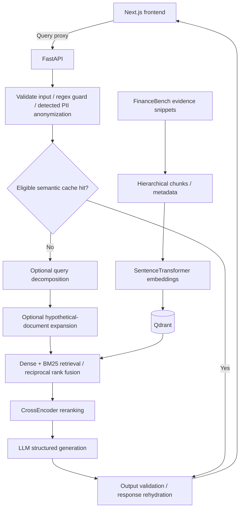

# SecureRAG architecture

SecureRAG is an experimental financial QA system. See [engineering decisions](ENGINEERING_DECISIONS.md) for tradeoffs and [benchmark protocol](BENCHMARKS.md) for evidence limits. Team ownership is recorded in the README.

## Runtime boundaries

- `api/`: middleware, payload validation, query/ingestion routes, semantic cache, and optional tracing. The health endpoint reports API liveness, not end-to-end retrieval readiness.
- `ingestion/`: downloads FinanceBench evidence snippets, chunks them at multiple sizes, embeds text, and writes vectors/payloads. Gold questions/answers are stored separately for evaluation.
- `retrieval/`: embeds queries, combines dense results with an in-memory BM25 index, optionally generates HyDE/decomposed queries, and reranks candidates. The BM25 index is cached per process and requires a restart after corpus changes. Its current scroll is bounded to 10,000 records; larger-corpus completeness is not established.
- `generation/`: provider clients and templates with Instructor/Pydantic structured response validation. Schema validation is not a guarantee of financial correctness.
- `security/`: regex input checks, Presidio anonymization/rehydration, and output validators. These are experimental controls, not proof against arbitrary prompt injection or PII leakage.
- `frontend/`: Next.js query UI, source-context expansion, and API liveness badge. A production build is not proof that a deployed provider-backed query succeeds.

The API uses Qdrant for vectors and Redis for the semantic cache. PII-bearing responses are excluded from the shared cache; sanitized text is used for retrieval/generation and answer tracing. Presidio detection can miss entities. The choice of cache threshold is configuration, not a published accuracy measurement.

## Evaluation

Ordinary CI runs lint/format, backend unit/integration tests, and frontend lint/build. Live DeepEval evaluation is an explicit workflow dispatch requiring provider keys; it does not run on every PR.

The A/B runner compares five retrieval configurations on one seeded sample with the HTTP cache and decomposition bypassed. It preserves every attempt and its failures, dataset/corpus hashes, model/package metadata, answers, context, judge reasons, and successful-sample bootstrap intervals. See `scripts/run_ab_test.py` and `evaluation/benchmark.py`.

No comparative results have been published. Current evidence snippets do not establish full-filing performance, and LLM judge metrics do not prove numerical financial accuracy. Synthetic/tuning questions must remain separate from the held-out comparison.

## Infrastructure status

Local Compose describes API, Qdrant, and Redis services. Frontend hosting configuration and a Fly.io API configuration exist in the repository; the complete live deployment was not verified in this update. Provider/model availability, ingestion, corpus freshness, and actual end-to-end responses must be checked before treating the system as a working hosted demo.
