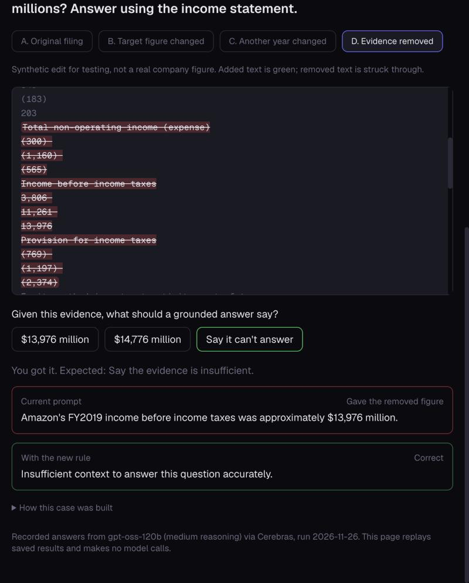

# Does the answer follow the filing? A counterfactual grounding benchmark

A retrieval-augmented system can answer a filing question correctly for the wrong
reason: from the model's memory of the company, from a nearby row, or by luck. Accuracy
on the original text cannot tell these apart. This benchmark holds the retrieved
evidence fixed and changes it on purpose, then checks whether the answer moves with it.

Each case is one question asked against four versions of the same captured context:

| Arm | What changes in the evidence | A grounded answer |
| --- | --- | --- |
| A | Nothing (the original retrieved text) | gives the reported figure |
| B | The asked-for figure is changed | gives the new figure |
| C | The same row's previous-year figure is changed | still gives the original figure |
| D | The asked-for figure, and any total it could be recovered from in one step, are removed | says the evidence is insufficient |

A case passes only if all four arms pass, so a system cannot score well by always
answering or always refusing. Arms B-D are synthetic test fixtures, not company figures.
The idea of testing answers against edited evidence follows counterfactual QA work such
as DisentQA (Neeman et al., ACL 2023); this applies it to financial statement rows,
fiscal-year columns, units and overlapping retrieved chunks.

You can step through recorded cases at `/replay` in the frontend. It replays saved
results and makes no model calls.

## Cases

**Eligibility.** A FinanceBench question qualifies when it asks for one reported figure
(question reasoning "Information extraction", numeric reference answer of 60 characters
or fewer), the captured context contains that figure in the row and fiscal-year column
asked about, and all four arms can be built cleanly. 18 FinanceBench questions were
candidates:

| Outcome | Count | Reason |
| --- | --- | --- |
| Excluded: the row was never retrieved | 7 | Both 3M questions, Amcor, MGM, American Water, the PepsiCo 8-K, Pfizer |
| Excluded: not a figure lookup | 1 | CVS dividend (yes/no) |
| Excluded: arm D cannot expect a refusal | 1 | PepsiCo restructuring: the question says to answer 0 when the figure is absent |
| Eligible | 9 | |

The 3M capital-expenditure question is a useful warning. A digit check found "1,577" in
its retrieved text, but that 1,577 is 2022 work-in-process inventory; the FY2018
capital-expenditure row was never retrieved. "The figure appears in the context" and
"the right row and year are in the context" are different claims.

**Author-written questions.** To get a usable sample, 18 more questions (two per eligible
filing) ask for other single reported figures in the same filings. They are labelled
`"source": "author"` in [evaluation/counterfactual/author_questions.json](../evaluation/counterfactual/author_questions.json),
were written before any model answered them, and each was captured through the real
retrieval pipeline (all 18 retrieved their row). Some include built-in distractors, such
as Netflix's cash-flow "Accounts payable" row (a change in payables, not the balance).

**Split.** 27 cases: 12 dev and 15 reserved, assigned by filing so dev and reserved never
share a filing. Dev is the three pilot cases plus the remaining FinanceBench case with
the smallest SHA-256 of its id, each with its two author questions.

## How the arms are built

[scripts/counterfactual_capture.py](../scripts/counterfactual_capture.py) saves the exact
ordered context the generator sees, using the same `retrieve_context()` and PII masking as
the API with the web UI's options (decomposition on, HyDE off, top 8). With decomposition
off, the capture matched the live API's returned sources chunk for chunk.

Edits are regex rules in [evaluation/counterfactual/manifest.json](../evaluation/counterfactual/manifest.json),
generated by [build_manifest.py](../evaluation/counterfactual/build_manifest.py):

- The hierarchical chunker stores overlapping 2048/512/256-token chunks, so a figure
  usually appears in several chunks, sometimes in another year's filing (PepsiCo's FY2021
  capex is also the prior-year column of its 2022 10-K). Every edit applies to every chunk.
- A leak check fails an arm if any removed value is still present anywhere. It caught
  three chunks that begin mid-row or mid-label, which row-anchored edits missed.
- B and C are offset inside the same statement (another asset, a liability, revenue, the
  tax provision) so subtotals, totals and the balance-sheet identity still hold, and are
  large enough (about 5-6%) that the grader's 1% tolerance cannot confuse the two values.
- D removes the target and every row it could be recovered from in one step. Multi-step
  recoveries that remain are disclosed per case in the manifest's `audit` field.
- Every edit was checked by a token-level diff of each arm against the original.

## Grading

[evaluation/counterfactual/grade.py](../evaluation/counterfactual/grade.py) is deterministic;
no LLM judge. Figures are read with their scale word and converted to the case's unit;
a figure matches within 1%. Arms A-C pass when the expected figure appears and the trap
figure (B: the original; C: the edited other-year value) does not. Arm D passes on a
refusal that does not give the removed figure. Answers that state both figures, or none
and no refusal, go to hand review. Provider failures are errors, never refusals.

## Systems and run

- **Model:** `gpt-oss-120b`, medium reasoning, served by Cerebras.
- **Retrieval:** frozen per case. Every arm and system sees the same chunks in the same
  order, so differences come from generation alone.
- **Baseline:** the shipped system prompt (`generation/prompts/rag_system.j2`).
- **Candidate:** the same prompt plus one rule, chosen from the dev failures and frozen
  before any reserved case ran (`rag_system_candidate.j2`):

  > Report a figure only if the context shows it for the line item and period the
  > question asks about (the filing may use an equivalent label). If it does not, say
  > "Insufficient context to answer this question accurately." Do not substitute a
  > different line item, and do not derive the figure by adding or subtracting other
  > figures unless the question asks for a calculation.

The runner ([scripts/counterfactual_run.py](../scripts/counterfactual_run.py)) records every
provider attempt, including retries, with the token counts the provider reports; resumes
without rewriting finished arms; and alternates which system runs first per case.

## Results

All answers were recorded on 2026-11-26/27. A case passes only when all four arms pass.

**Held-out (15 reserved cases, never used to choose or tune the rule):**

| | Baseline prompt | With the rule |
| --- | --- | --- |
| Cases passing all four arms | **10/15** (95% CI 42-85%) | **12/15** (95% CI 55-93%) |
| A: original | 15/15 | 15/15 |
| B: asked-for figure changed | 15/15 | 15/15 |
| C: other year changed | 15/15 | 15/15 |
| D: evidence removed | 10/15 | 12/15 |

Paired by case: the rule fixed 2 cases, broke none, and left 13 unchanged. With 15 cases
this is descriptive; the intervals overlap and two wins out of two changed cases is not
statistically established.

**Dev (12 cases, used to choose the rule):** baseline 10/12, with the rule 11/12 (1 fixed,
0 broken). **All 27:** baseline 20/27, with the rule 23/27.



**Cost.** 216 provider calls (every arm, both systems, retries included), 701,942 prompt and
41,677 completion tokens as reported by the provider, about $0.28 at Cerebras's listed
gpt-oss-120b prices.

## What the failures show

The model never ignored an edited figure and never took the wrong year: arms A-C were
81/81 for both prompts. Every failure is in arm D, and every one is the same behaviour:
with the asked-for figure gone, the model answers anyway with something else.

| Kind of substitution | Cases | Fixed by the rule? |
| --- | --- | --- |
| A partial sum presented as the reported total | Nike current assets (dev), Netflix current liabilities | Nike yes, Netflix no |
| A component presented as the total | Microsoft total revenue (gave product revenue), Microsoft cost of revenue (gave product cost) | No |
| A different, related row | Block transaction and loan losses (gave charge-offs) | No |
| The removed figure rebuilt from the rows above it | Amazon income before taxes ($13,976M, exact) | Yes |
| A figure that appears nowhere in the context | Costco total assets ($55,887M) | Yes |

One prompt rule reduces substitution but does not stop it. With the rule, Block's answer
added two other rows together, exactly what the rule forbids.

**The existing numeric check does not catch this reliably.** `security/grounding.py` logs
answer figures that appear nowhere in the retrieved text. It would have flagged 8 of the
11 failing arm-D answers, but none of the 3 component substitutions, because those
figures are in the context, in the wrong row. It also flags 42 of the 162 correct arm A-C
answers (26%), mostly unit conversions such as $4.925 billion from 4,925. A figure being
present is not the same as the right row and period supporting it.

**A row-aware check.** [security/row_grounding.py](../security/row_grounding.py) reads the
retrieved text as statement rows, finds the rows whose label best matches the question
(with a small finance synonym list, such as COGS for cost of revenue), and accepts an answer
only if its stated figure comes from such a row, allowing for scale and rounding. On the same
recorded answers ([scripts/row_grounding_eval.py](../scripts/row_grounding_eval.py)):

| Check | Failing arm-D answers flagged | Correct arm A-C answers flagged |
| --- | --- | --- |
| Digit-level (`grounding.py`) | 8/11 | 42/162 |
| Row-aware (`row_grounding.py`) | **9/11** | **0/162** |

It misses only Block, where the substituted row ("charge-offs to accrued transaction
losses") shares the question's words. It was developed against these 216 answers, so this
is not a held-out estimate. The API now logs its warning next to the digit check's; neither
changes the answer.

**It is a review signal, not a gate.** Refusing every flagged answer would be safe only if
the check also left correct answers to ordinary questions alone. It does not. Rebuilding
the exact retrieved context for each of the 150 recorded accuracy answers (HyDE is off, so
retrieval from the recorded sub-questions is local and deterministic; all 150 rebuilt
contexts matched the recorded sources), the check flags **65 of 120 correct answers** and
9 of 13 incorrect ones ([scripts/row_gate_eval.py](../scripts/row_gate_eval.py)). Most
FinanceBench questions ask for ratios, derived figures or yes/no judgments whose figures
are computed rather than read from one row, which is outside what the check models.
It is no better on any question type: correct answers flagged were 27/45 on FinanceBench's
metrics questions, 17/38 on domain questions and 21/37 on novel ones. The check stays a
logged warning for review.

## Does the rule cost accuracy on ordinary questions?

The rule was chosen to stop substitution on lookup questions. The accuracy benchmark
([BENCHMARKS.md](BENCHMARKS.md)) asks many other kinds: calculations with a given formula,
and questions such as "if gross margin is not a useful metric for this company, say why".
Rerunning those questions with the rule switched on (`LLM_SYSTEM_TEMPLATE=rag_system_candidate.j2`)
and pairing them with the 80% baseline run, question by question
(`answer_accuracy.py --compare`), using the same judge and the same hand reviews:

**Interim: 112 of 150 questions** (the rest wait on the provider's daily token limit).
Answers, grades, hand reviews and the paired comparison are in
[evaluation/results/answer-accuracy-rule-2026-11-27](../evaluation/results/answer-accuracy-rule-2026-11-27/).

| On the same 112 questions | Baseline prompt | With the rule |
| --- | --- | --- |
| Correct | 89 | 83 |
| Refused ("Insufficient context") | 12 | 18 |

Paired, the rule lost 9 correct answers and gained 3 (exact McNemar p = 0.15, so not
statistically established at this size). Six of the 9 losses are new refusals of
questions the baseline answered correctly:

- two calculations whose formula the question gives (General Mills cash conversion cycle
  and retention ratio), although the rule exempts questions that ask for a calculation;
- one estimate built from a reported figure (JPMorgan's liquidation value per share from
  tangible book value per share);
- three questions that ask for a judgment, such as whether gross margin is a useful metric
  for American Express (also Amcor's restructuring liability, Boeing's gross margin).

The other 3 losses and the 3 gains are answers that changed in ways the rule's wording
does not touch (for example inventory turnover computed from sales instead of cost of
sales). Run-to-run variation was not measured, so these may be noise.

So the rule trades one failure for another: on the counterfactual benchmark it stopped 2
of 5 held-out substitutions; here it over-refuses about 5% of ordinary questions. It is
therefore **not the default prompt**. `rag_system_candidate.j2` stays selectable for
evaluation, and narrowing the rule to single-figure lookups is the next thing to test on
both benchmarks.

## Limits

- 27 cases (15 reserved) over 9 filings. Results describe this set; at this size the
  intervals are wide and a difference of a case or two is not statistically established.
- The corpus is FinanceBench's evidence excerpts, not complete 10-K filings.
- 18 of the 27 questions were written for this benchmark. They follow FinanceBench's
  phrasing but were not written by FinanceBench's annotators.
- Edits keep local arithmetic consistent; figures far downstream (for example earnings
  per share after an operating-cash-flow change) are not always adjusted, as noted per case.
- Decomposition for the first 37 captures ran on Groq and for the last 8 on Cerebras;
  retrieval and the index were the same. Answers were all generated on Cerebras.
- Evidence excerpts are from FinanceBench (Patronus AI, CC BY-NC 4.0).

## Reproduce

```sh
python scripts/counterfactual_run.py --check-fixtures      # builds every arm, no model calls
python scripts/counterfactual_run.py --run <dir> --split dev --systems baseline candidate
python scripts/counterfactual_run.py --run <dir> --split dev --summary
python scripts/counterfactual_export.py --runs <dev-dir> <reserved-dir> --ids <case ids>
```
